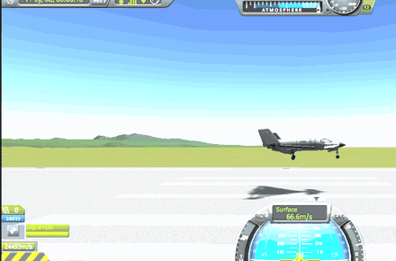

# KSP Wingman

**An AI agent that joins your [Luna Multiplayer](https://github.com/LunaMultiplayer/LunaMultiplayer) (LMP) server in
Kerbal Space Program as a player, and plays with you.**

A local agent (Claude Code, or any agent that speaks [MCP](https://modelcontextprotocol.io)) drives its own KSP
through [kRPC](https://krpc.github.io/krpc/). It's a real player on your server: its own vessel, held by LMP's normal
locks, so it can only ever fly its own craft. It talks with you in LMP's chat.

A **LUNA Evolved** project, from the makers of [LUNA EVO Mission Control](https://github.com/NEON-NULL-NARWHAL/luna-evo-mission-control).

> [!NOTE]
> **Version 0.12: explore, riskier approaches, fuel.** The agent chats, takes off, flies where it's told, flies
> formation on you, and lands on KSC's runway on the approaches a tower clears it for (or its own flight plan). It
> practises on its own and learns from every flight; it **tests each new plane** on the ground and in the air and flies
> it with that plane's own setup; it can **explore** the map on legs it chooses, try **riskier finals** within its
> plane's limits, and watches its **fuel**. A model on your own PC can be the pilot (the Wingman console, below).
> Next: taking over a craft you hand it, missions you approve, rescues ([research notes](docs/RESEARCH.md)).


*The agent's KSP, in the test rig: its plane (front right) holding a slot beside the other player's (left), both at
1,500 m and 120 m/s. The other plane is where LMP shows it.*

## What you need

- **KSP 1.12.5** with **LMP 0.29.2** (the server and the players).
- **A second KSP for the agent**, on this PC or another one. It's your own copy, running twice. A second PC is
  better: a second KSP takes 3-5 GB of memory and CPU, and a KSP that slows down falls out of step with the others.
- **[kRPC 0.7.0](https://github.com/krpc/krpc/releases)** in the agent's KSP.
- **An agent that speaks MCP**, for example [Claude Code](https://claude.com/claude-code), **or a model on your own
  PC** through the Wingman console: [Ollama](https://ollama.com), llama.cpp's `llama-server`, or any server with the
  OpenAI chat API (see [the console](#the-wingman-console-local-models)).
- Recommended: the **[LUNA EVO patches](https://github.com/NEON-NULL-NARWHAL/luna-evo-mission-control)** in every
  KSP, so players (and the agent) stay in step in time and see each other.

## Install

1. Download `KspWingman-<version>.zip` from the [latest release](https://github.com/NEON-NULL-NARWHAL/ksp-wingman/releases/latest).
2. Into the **agent's** KSP: copy the zip's `GameData/KspWingman` folder into KSP's `GameData`, next to `kRPC` and
   `LunaMultiplayer`.
3. Put `KspWingman.Mcp.exe` and `KspWingman.exe` in one folder, anywhere (single files, nothing to install).
4. Start the agent's KSP, join your server with LMP (pick a player name for it, e.g. "Wingman"), and let it reach the
   Space Center. kRPC's server should be running (its window: Start server; default port 50000).
5. Then either:
   - **Claude Code (or another MCP agent):** add the MCP server, then ask your agent to say hello in the chat:

     ```
     claude mcp add ksp-wingman --env WINGMAN_KRPC_PORT=50000 -- "C:\path\to\KspWingman.Mcp.exe"
     ```

     For an agent's KSP on another PC, add `--env WINGMAN_KRPC_HOST=<its address>` (and allow kRPC's ports there).
   - **A local model:** install [Ollama](https://ollama.com), get a small model, and start the console:

     ```
     ollama pull qwen3:4b-instruct
     KspWingman --model qwen3:4b-instruct --krpc-port 50000 --allow "YourName"
     ```

     Then type an order ("take off and fly east at 1000 m"), or say "Wingman, take off" in LMP's chat.

## The tools

| Tool | What it does |
|---|---|
| `status` | The agent's player name, whether it's in a server, the scene, and in flight its vessel, altitude, speed, heading and position. Also says if it's behind the others in time. |
| `players` | The other players: name, the vessel they fly, LMP's status line ("Flying above Kerbin"). |
| `read_chat` | LMP's chat lines after a line number, oldest first. |
| `send_chat` | Says one line in LMP's chat, as the agent's player. |
| `wait_for_chat` | Waits until someone else says something (up to 2 minutes), then returns the new lines. |

**Flying:**

| Tool | What it does |
|---|---|
| `launchable_craft` | The craft the agent's KSP can launch, from the VAB and the SPH. |
| `launch` | Launches a craft onto the runway (planes, rovers) or the launch pad (rockets). |
| `take_off` | Takes a plane off the runway: rolls straight along the runway on the nose wheel, lifts off at takeoff speed, gear up, climbs out, then turns to the heading and flies on at the altitude and speed given. |
| `test_plane` | Tests the plane (0.11). On the runway, stopped: a ground test (a roll with the nose wheel straight, a steering pulse, a brake stop; about a minute). In the air: a flight test (an elevator and an aileron pulse, a 180° turn, slowing at idle to its slowest speed, full throttle; about four minutes from 1,500 m). From the numbers the pilot sets itself up for that plane (steering, rotate, approach and landing speeds); with LUNA EVO's tower every agent gets them. `status` shows the setup. |
| `fly` | Flies the plane at a heading, altitude and speed, and keeps it there. Turns by banking, at most 30°. |
| `follow` | Formation on another player: a slot to their right, behind, above (default 40 m right, 50 m behind), never closer than 30 m. From further than 2 km it flies straight at them first (even head-on), and closes no faster than it can slow down again. |
| `land` | Lands on KSC's runway (landing east) from anywhere in the air. The tower clears a published approach for where the plane is (or give one, or `"visual"` for a plain circuit); the pilot flies its fixes, then the final down a 4° glide slope, flares, rolls out on the centerline and brakes. Goes around by itself if it isn't lined up and on the slope by 600 m before touchdown (it risks the landing until then), or the ground comes up too close, and the tower clears it again; brakes by the runway left, and goes around from the runway when it can't stop. `finalSpeed` and `glideSlope` choose the final (0.12), within the plane's limits. Takes a few minutes. |
| `explore` | Flies to a point it chooses (0.12): a bearing and a distance from where the plane is, at an altitude; notes what's there (the biome, the ground's height) for every agent, then flies on. Clears the ground on the leg by 500 m (raising the altitude, and looking 12 km ahead in flight; 0.12.1); refused past 60 km from KSC, for legs over 30 km, for ground rising faster than the plane climbs, or without the fuel to get there and back with 25% left. |
| `approaches` | The published approaches and their fixes, with the height and speed to cross each at (see [the tower](#the-tower-and-its-approaches)). |
| `stop_following` | Holds the current heading, height and speed. |
| `stage`, `set_controls`, `stop_flying`, `recover` | Next stage; brakes, gear, SAS, lights; hand the vessel back; recover a landed vessel. |
| `knowledge` | What the server's agents know (LUNA EVO's tower, 0.7): the skills (take off, fly a route, hold, land visual, land RNAV, land in sequence), how many of your flights and everyone's went well, which are open to practise, the lessons earlier flights taught (facts, not orders), and your last flights. |
| `learn` | Saves a lesson for every agent on the server, citing one of your flights that showed it (refused without one). The console's debrief uses it; the model doesn't get it. |
| `procedures` | The tower's published table (0.9): its fixes, the legs between them and the final fixes, for a flight plan of the agent's own. Free flight's planner uses it; the model doesn't get it. |
| `file_plan` | Files a flight plan (fix names, e.g. `KSC-OH KSC-N1 KSC-N2 KSC-N3 F09`) with LUNA EVO's tower: it's checked against the table and cleared as filed, or the tower says why not. Free flight uses it; the model doesn't get it. |
| `events` | What happened since an event number, as JSON lines: flight phases (parked, taking off, climbing, cruising, on a route, holding, on final, flaring, rolling out, stopped, taxiing, crashed...), each flight's outcome (landed and where on the runway, crashed, splashed, go-arounds, the approach flown) and the tower's messages. For apps watching agents; the console shows them too. |

### The tower and its approaches

Like a real airport, KSC's runway 09 has published approaches, and `land` asks a tower which one to fly:

| Approach | When | Fixes (height, speed) |
|---|---|---|
| `RNAV 09 STRAIGHT-IN` | far out west, already facing the runway | KSC-W12 (900 m, 120 m/s) → F09 |
| `RNAV 09 NORTH` | north of the runway, or arriving from the north | KSC-N1 (900 m, 110 m/s): downwind 4 km north → KSC-N2 (800 m, 90 m/s) → base → KSC-N3 (750 m, 90 m/s) on the centerline 11 km out → F09 |
| `RNAV 09 SOUTH` | south of the runway, or arriving from the south | the same, 4 km south: KSC-S1 → KSC-S2 → KSC-S3 → F09 |

**With LUNA EVO's tower (0.5).** [LUNA EVO Mission Control](https://github.com/NEON-NULL-NARWHAL/luna-evo-mission-control)
2.11 has a real tower for several agents (rail: Play → KSC tower). Start it there, and give each agent
`WINGMAN_TOWER_URL=http://localhost:8920/` (in `claude mcp add ... --env`, or the environment of the console). Then the
agent reports to it every few seconds, answers "say intentions", and `land` asks the tower: one plane is cleared with
the whole route, the next holds (circling a hold point, stacked 300 m apart) until the first has landed and vacated
the runway. Told to vacate (0.6), the agent taxis off to the right at walking pace and parks 90 m beside the runway,
brakes on; the tower clears the next plane as soon as it's off. The tower's last message shows in status.
Close in with nobody else waiting, the tower (Mission Control 2.13) clears the **short visual** instead of an RNAV
route: the RNAV pattern made smaller (downwind 3 km to the side, the base turn 7 km out, a 4.5 km final), about 16 km flown instead of 25. `land` with an approach's
name asks the tower for it; it's granted when nobody else is waiting.


F09 is the final approach fix: on the centerline 8 km out, 628 m up, where the 4° glide slope starts. The tower
answers like ATC: `KSC tower: Wingman, cleared RNAV 09 SOUTH. Proceed to KSC-S1 at 900 m, 110 m/s, then KSC-S2,
KSC-S3, F09, land KSC runway 09.` (status shows it while landing). The pilot stays on the line between fixes and
turns early, by the turn's radius, like fly-by waypoints. A plane already lined up on the slope skips the route.

The agent decides what to fly; a pilot in the MCP server flies it, 20 times a second, between the agent's calls (an
agent thinks in seconds, a plane needs a hand on the stick all the time). Deliberately missing: time warp (it moves the
agent away from the other players in time) and revert (it rewrites the shared universe).

**Guardrails in the pilot:** at most 30° of bank and a quarter stick; gentler controls at high speed; below 150 m
above the ground and sinking, it levels the wings and climbs, whatever it was told; never faster than 250 m/s when
following; it stops (and says so) when the plane lands, splashes down or is destroyed. If the MCP server is closed
mid-flight, it turns SAS on first.

**Guardrails, built into the bridge:** chat lines are one line, at most 300 characters, at most one a second. The agent
only ever controls its own KSP; LMP's locks keep it off everyone else's vessels.

## The Wingman console: local models

`KspWingman.exe` lets a model on your own PC (or your own server) fly: [Ollama](https://ollama.com), llama.cpp's
`llama-server`, or any server with the OpenAI chat API. It starts `KspWingman.Mcp.exe` (put both in one folder) and
uses the same tools.

```
KspWingman --model gemma4:e4b --planner-model gemma4:e4b --krpc-port 50000 --allow "YourName,FriendName"
```

**Orders** come from the console (type "take off and fly east at 1000 m") or from LMP's chat: players on `--allow`
start a line with the call sign (`Wingman, follow me`, `@Wingman land`) or the agent's player name. The answer goes
back where the order came from, as one chat line. Without `--allow`, chat orders are off.

| Option | What it does | Default |
|---|---|---|
| `--model` | The model's name on the server (for Ollama, one from `ollama list`). Required. | |
| `--llm` | The server's OpenAI-compatible address: `http://127.0.0.1:8080/v1/` for llama.cpp, another PC's address for a model server elsewhere. | `http://127.0.0.1:11434/v1/` (Ollama) |
| `--api-key` | For a server that wants one. | none |
| `--krpc-host`, `--krpc-port` | Where the agent's KSP runs kRPC. | `127.0.0.1`, `50000` |
| `--allow` | Players who may give orders in chat, comma-separated. | none (chat orders off) |
| `--call-sign` | What players call the agent in chat. | `Wingman` |
| `--mcp` | Path to `KspWingman.Mcp.exe`. | next to `KspWingman.exe` |
| `--think` | Let a thinking model think (slow: 20+ s per answer). | off |
| `--planner-model` | A model that thinks, for free flight's choices and the debriefs (it never flies). With Ollama it thinks through Ollama's own API. | the pilot's model |
| `--planner-llm` | The planner's server. | the pilot's |
| `--ipc` | For an app running the console (LUNA EVO Mission Control's Wingman page): one JSON object a line in and out, see below. | off |

The same settings can come from the environment: `WINGMAN_MODEL`, `WINGMAN_LLM_URL`, `WINGMAN_LLM_KEY`,
`WINGMAN_KRPC_HOST`, `WINGMAN_KRPC_PORT`. `WINGMAN_EVENTS_LOG=<file>` (for the MCP server) also writes every event
to a file, one JSON line each.

**Free flight and learning (0.7).** `/free 30` (or `{"type":"free","minutes":30}`) lets the agent practise on its own
for 30 minutes: the planner picks a goal from a numbered menu (land on RNAV 09 NORTH, SOUTH, STRAIGHT-IN, or the
short visual), preferring its weakest skill, and code flies it: a new plane if needed, take off, land on that approach.
Code keeps it in the box (25 km around KSC, below 3,000 m: outside, it's sent back to land), stops after two crashes in
a row, drops a goal that failed twice without a lesson, and any order stops free flight. With LUNA EVO's tower, each
finished flight is graded on the server, and the **debrief** follows: the planner reads the flight's record and writes
one lesson ("On RNAV 09 SOUTH, slow to 85 m/s before F09 to avoid a go-around"), which code checks and saves citing the
flight. Every agent on the server then sees it in `knowledge`. Debriefs also follow ordinary flights.

**Training (0.9-0.12).** `/train <what> [minutes]` (or `{"type":"train","focus":...}`, or asking the pilot in plain
words: it has a `train` tool) practises one thing until it has 3 good flights in a row: `landings`, `fast`, `high`,
`planes` (a plane it hasn't flown: tested on the ground and in the air first, then flown with its own setup, and the
planner writes a note on how it differs), `plans` (its own flight plan from the tower's table), `approaches` (a
riskier final it picks: steep, shallow, fast, slow or long, within the plane's limits) or `explore` (it picks each leg,
a bearing, distance and height; code checks range and fuel; it notes what's there for every agent, then lands). Free
flight's menu has all of them.

**Each plane's own setup (0.11).** `test_plane` measures a plane (on the runway: its nose wheel, how it veers, its
brakes; in the air: how quickly it pitches and rolls, its slowest speed, how it slows and speeds up), and the pilot
flies it with its own gains and speeds, corrected by how its finals go (weaving, arriving high). Its **limits** (the
final approach speeds, touchdown speed and the steepest glide slope it can take) are on `status`, and `land` takes a
`finalSpeed` and `glideSlope` within them. With LUNA EVO's tower the tests are kept for every agent.

**`--ipc`:** the console reads `{"type":"order","text":"land at KSC","from":"Commander"}`, `{"type":"status"}`,
`{"type":"forget"}`, `{"type":"free","minutes":30}`, `{"type":"train","focus":"explore","minutes":30}`, `{"type":"stop-free"}` or `{"type":"quit"}` (quits without asking), one a line (plain text is an order), and writes
everything as `{"type":"event","time":...,"kind":...,"text":...,"data":...}`: kinds `order`, `chat`, `call`, `result`,
`answer`, `status`, `error`, `wingman`, `free`, `debrief`, and every 2 s the MCP server's events: `phase`, `flight` (an
outcome), `tower`, `knowledge` (the flight's grades), `lesson`, `test` (a plane's test results) and `place` (an
explored place). [LUNA EVO Mission Control](https://github.com/NEON-NULL-NARWHAL/luna-evo-mission-control) 2.12 installs
Wingman, its mod and a model, and runs agents this way (rail: Play → Wingman).

**In the console:** `/status` (where the agent is), `/forget` (clears the conversation), `/quit`. While the pilot is
still flying, `/quit` warns first: quitting stops the pilot and leaves the plane on SAS with nobody flying it. Type
`/quit` again to leave anyway.

**Guardrails in the console:** the model never gets the chat tools (the console reads the chat and says the answers
itself, so it can't flood the chat); only players on `--allow` can give orders; answers are one line without emoji.

A real session in the test rig (another player, RigPilot, giving orders in LMP's chat; the model is Qwen3 4B
instruct on the same PC as both KSPs):

```
08:35:21 you  Commander: launch a new plane, take off and fly north at 800 meters
08:35:21 tool launchable_craft({})
08:35:22 tool launch({"craft":"Aeris 3A","site":"Runway"})
08:35:32 tool take_off({"heading":0,"rotateSpeed":1,"climbPitch":10,"altitude":800})
08:35:49   -> Airborne: 100 m above the ground at 130 m/s on heading 0°, gear up. Now flying on: heading 0°, 800 m, 150 m/s.
08:35:49 ai   Flying north at 800 meters altitude, heading 0°. Ready for your next command!
08:36:33 chat RigPilot: climb to 1500 m and turn east
08:36:33 tool fly({"heading":90,"altitude":1500,"speed":150})
08:36:33 ai   Climbed to 1500 meters and turned east. Ready for your next command!
08:46:40 chat RigPilot: come back and land at KSC
08:46:41 tool land({"runway":"KSC"})
```

(`rotateSpeed: 1` is the model's; `take_off` makes it 40.)




*`land` in the rig (0.4): the tower's RNAV 09 SOUTH, then the flare, touchdown and rollout, 3 m off the centerline.*

**Which model:** `gemma4:e4b` (0.8) passes the same 24 of 24 orders and is also the best planner in PlannerEval, so it
can do both with `--model gemma4:e4b --planner-model gemma4:e4b`; it takes 0.4 GB of the graphics card next to two
KSPs. Before that: a small non-thinking one. On a 16 GB card next to two KSPs, `qwen3:4b-instruct` (3 GB) answers in
about a second and passed 24 of 24 orders in our eval. In the game it missed one of five: it answered "come back and
land" with `fly` once, and with `land` when asked again. Thinking models take 20+ s per answer. The console helps
small models along: it reads tool calls they write out as text, and when one says "Following you!" without calling
`follow`, it tells it so. To try another model on the same orders, without KSP:

```
dotnet run --project tests/ModelEval -- "C:\path\to\KspWingman.Mcp.exe" <model> [server URL] [runs per order]
```

To compare **planner** models (debriefs and free-flight choices, through the console's own code, no KSP): real flight
records from the rig (or a `knowledge.json` from LUNA EVO's tower) and goal menus, scored on what the console accepts
and how long each answer takes:

```
dotnet run --project tests/PlannerEval -- --models qwen3:4b,qwen3:8b,gemma4:e4b [--flights knowledge.json] [--runs 3] [--report report.md]
```

## How it works

- **The bridge** (`src/KspWingman.Bridge`, a KSP mod) adds a kRPC service called `Wingman` for what kRPC can't see by
  itself: LMP's chat, players and time. It runs on KSP's main thread, like LMP's own windows.
- **The MCP server** (`src/KspWingman.Mcp`, .NET 10) connects to kRPC in the agent's KSP and turns the game into tools.
  Its pilot (`Pilot`, `Formation`, `Landing`) flies between the agent's calls.
- **The console** (`src/KspWingman.Tui`, .NET 10) is an agent of its own for local models: it starts the MCP server,
  sends the model the orders and the tools, and runs the tools it asks for.
- Nothing new goes over LMP's network: the agent is a normal LMP player.

The maintainer's guide, chapter by chapter (the pilot, landing, the tower client, learning, explore and fuel, the
bridge, tests, releases, gotchas), is in [Meat and Potatoes](Meat%20and%20Potatoes/README.md).

## Building it

.NET 10 SDK, then `dotnet build KspWingman.slnx` and `dotnet test KspWingman.slnx`. No KSP needed: kRPC and LMP's
DLLs the bridge builds against are in `lib/` (see [`lib/THIRD-PARTY.md`](lib/THIRD-PARTY.md)), and KSP's and Unity's
names come from LUNA EVO's own stand-ins in `src/Stubs` (no Squad or Unity code).

Tools for working on it, against a real KSP:

- `tests/mcp_smoke.py <KspWingman.Mcp.exe> <kRPC port> tool[:json] ... sleep:N` talks MCP to the server like an
  agent's host would, e.g. `"take_off:{\"altitude\":600}" "land:{}" sleep:10 status`.
- `tests/FlightLab <kRPC port> probe|hold|steps|test|ground|show|wreck|camera` flies or inspects the plane straight
  through kRPC, for tuning the pilot (`test` and `ground` measure the Aeris 3A's reference numbers).
- `tests/ModelEval` (above) scores a model without KSP.

## How it was made

Written by Claude (Anthropic's AI model), directed and reviewed by the project owner, like LUNA EVO Mission Control.
Version 0.1 was checked with two real KSPs on one LMP server: the agent's chat reached the other player, and the
other player's reply reached the agent. Version 0.2 was flown in the same rig: two agents, each in its own KSP, one
holding a course and the other taking off and joining it in formation (and, on the way there, crashing a few planes
into the sea; the fixes are in the changelog). Version 0.3 too: `land` from anywhere in the air, and a local 4B model
taking orders from the other player's chat, launching, taking off and landing. Version 0.4: four landings on the
tower's approaches, each lined up the first time; the rollout was tuned from the recordings. Since then, every
version was flown by two agents in the rig with LUNA EVO's tower: free flight and the debrief (0.7), runway in sight
(0.8), training, flight plans and the overhead hold (0.9), go-arounds resequenced (0.10), flight tests that turned the
Aeris 4A, which had never landed, into a plane landing 7 m off the centerline (0.11), and explore and riskier finals
(0.12).

## License

GPL-3.0 ([LICENSE](LICENSE)). kRPC's `KRPC.Core.dll` (LGPL-3.0) and LMP's client DLLs (MIT) are in `lib/` only to
build against; see [`lib/THIRD-PARTY.md`](lib/THIRD-PARTY.md).

Kerbal Space Program is a trademark of Take-Two Interactive. This project isn't affiliated with them, the LMP team or
the kRPC team.
