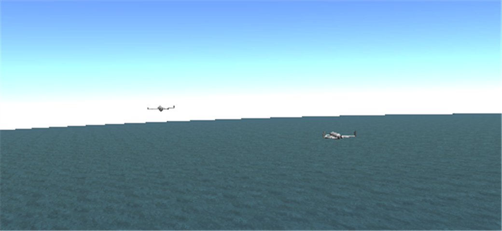
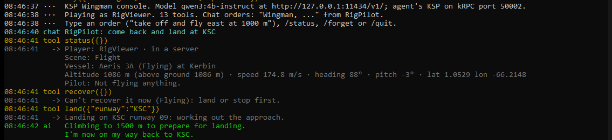
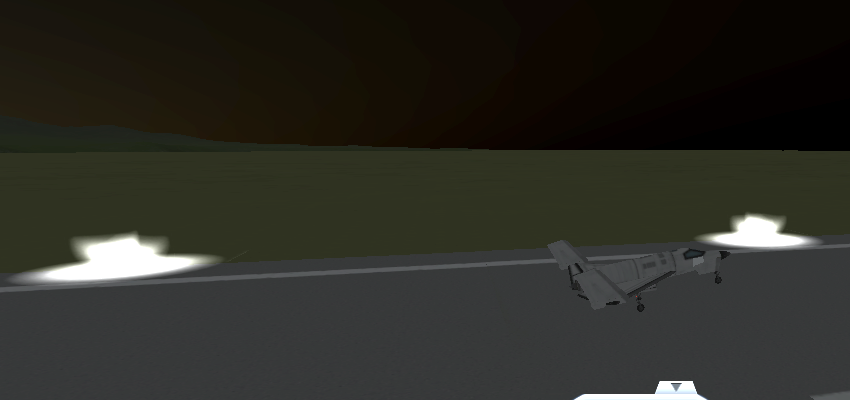

# KSP Wingman

**An AI agent that joins your [Luna Multiplayer](https://github.com/LunaMultiplayer/LunaMultiplayer) (LMP) server in
Kerbal Space Program as a player, and plays with you.**

A local agent (Claude Code, or any agent that speaks [MCP](https://modelcontextprotocol.io)) drives its own KSP
through [kRPC](https://krpc.github.io/krpc/). It's a real player on your server: its own vessel, held by LMP's normal
locks, so it can only ever fly its own craft. It talks with you in LMP's chat.

A **LUNA Evolved** project, from the makers of [LUNA EVO Mission Control](https://github.com/NEON-NULL-NARWHAL/luna-evo-mission-control).

> [!NOTE]
> **Version 0.3: local models.** The agent chats, takes off, flies where it's told, flies formation on you and lands
> on KSC's runway, and a model on your own PC can be the pilot (the Wingman console, below). Next: taking over a
> craft you hand it, missions you approve, rescues ([research notes](docs/RESEARCH.md)).



*The agent's KSP, in the test rig: its plane (front right) holding a slot beside the other player's (left), both at
1,500 m and 120 m/s. The other plane is where LMP shows it.*

## What you need

- **KSP 1.12.5** with **LMP 0.29.2** (the server and the players).
- **A second KSP for the agent**, on this PC or another one. It's your own copy, running twice. A second PC is
  better: a second KSP takes 3-5 GB of memory and CPU, and a KSP that slows down falls out of step with the others.
- **[kRPC 0.7.0](https://github.com/krpc/krpc/releases)** in the agent's KSP.
- **An agent that speaks MCP**, for example [Claude Code](https://claude.com/claude-code), **or a model on your own
  PC** through the Wingman console: [Ollama](https://ollama.com), llama.cpp's `llama-server`, or any server with the
  OpenAI chat API (see [the console](#the-wingman-console-local-models)).
- Recommended: the **[LUNA EVO patches](https://github.com/NEON-NULL-NARWHAL/luna-evo-mission-control)** in every
  KSP, so players (and the agent) stay in step in time and see each other.

## Install

1. Download `KspWingman-<version>.zip` from the [latest release](https://github.com/NEON-NULL-NARWHAL/ksp-wingman/releases/latest).
2. Into the **agent's** KSP: copy the zip's `GameData/KspWingman` folder into KSP's `GameData`, next to `kRPC` and
   `LunaMultiplayer`.
3. Put `KspWingman.Mcp.exe` and `KspWingman.exe` in one folder, anywhere (single files, nothing to install).
4. Start the agent's KSP, join your server with LMP (pick a player name for it, e.g. "Wingman"), and let it reach the
   Space Center. kRPC's server should be running (its window: Start server; default port 50000).
5. Then either:
   - **Claude Code (or another MCP agent):** add the MCP server, then ask your agent to say hello in the chat:

     ```
     claude mcp add ksp-wingman --env WINGMAN_KRPC_PORT=50000 -- "C:\path\to\KspWingman.Mcp.exe"
     ```

     For an agent's KSP on another PC, add `--env WINGMAN_KRPC_HOST=<its address>` (and allow kRPC's ports there).
   - **A local model:** install [Ollama](https://ollama.com), get a small model, and start the console:

     ```
     ollama pull qwen3:4b-instruct
     KspWingman --model qwen3:4b-instruct --krpc-port 50000 --allow "YourName"
     ```

     Then type an order ("take off and fly east at 1000 m"), or say "Wingman, take off" in LMP's chat.

## The tools

| Tool | What it does |
|---|---|
| `status` | The agent's player name, whether it's in a server, the scene, and in flight its vessel, altitude, speed, heading and position. Also says if it's behind the others in time. |
| `players` | The other players: name, the vessel they fly, LMP's status line ("Flying above Kerbin"). |
| `read_chat` | LMP's chat lines after a line number, oldest first. |
| `send_chat` | Says one line in LMP's chat, as the agent's player. |
| `wait_for_chat` | Waits until someone else says something (up to 2 minutes), then returns the new lines. |

**Flying:**

| Tool | What it does |
|---|---|
| `launchable_craft` | The craft the agent's KSP can launch, from the VAB and the SPH. |
| `launch` | Launches a craft onto the runway (planes, rovers) or the launch pad (rockets). |
| `take_off` | Takes a plane off the runway: rolls straight along the runway on the nose wheel, lifts off at takeoff speed, gear up, climbs out, then turns to the heading and flies on at the altitude and speed given. |
| `fly` | Flies the plane at a heading, altitude and speed, and keeps it there. Turns by banking, at most 30°. |
| `follow` | Formation on another player: a slot to their right, behind, above (default 40 m right, 50 m behind), never closer than 30 m. From further than 2 km it flies straight at them first (even head-on), and closes no faster than it can slow down again. |
| `land` | Lands on KSC's runway (landing east) from anywhere in the air: a circuit out to the final approach 8 km west of KSC, down a 4° glide slope, flare, roll out on the centerline, brakes. Goes around by itself if it isn't lined up, is too high, or the ground comes up too close, and tries again. Takes a few minutes. |
| `stop_following` | Holds the current heading, height and speed. |
| `stage`, `set_controls`, `stop_flying`, `recover` | Next stage; brakes, gear, SAS, lights; hand the vessel back; recover a landed vessel. |

The agent decides what to fly; a pilot in the MCP server flies it, 20 times a second, between the agent's calls (an
agent thinks in seconds, a plane needs a hand on the stick all the time). Deliberately missing: time warp (it moves the
agent away from the other players in time) and revert (it rewrites the shared universe).

**Guardrails in the pilot:** at most 30° of bank and a quarter stick; gentler controls at high speed; below 150 m
above the ground and sinking, it levels the wings and climbs, whatever it was told; never faster than 250 m/s when
following; it stops (and says so) when the plane lands, splashes down or is destroyed. If the MCP server is closed
mid-flight, it turns SAS on first.

**Guardrails, built into the bridge:** chat lines are one line, at most 300 characters, at most one a second. The agent
only ever controls its own KSP; LMP's locks keep it off everyone else's vessels.

## The Wingman console: local models

`KspWingman.exe` lets a model on your own PC (or your own server) fly: [Ollama](https://ollama.com), llama.cpp's
`llama-server`, or any server with the OpenAI chat API. It starts `KspWingman.Mcp.exe` (put both in one folder) and
uses the same tools.

```
KspWingman --model qwen3:4b-instruct --krpc-port 50000 --allow "YourName,FriendName"
```

**Orders** come from the console (type "take off and fly east at 1000 m") or from LMP's chat: players on `--allow`
start a line with the call sign (`Wingman, follow me`, `@Wingman land`) or the agent's player name. The answer goes
back where the order came from, as one chat line. Without `--allow`, chat orders are off.

| Option | What it does | Default |
|---|---|---|
| `--model` | The model's name on the server (for Ollama, one from `ollama list`). Required. | |
| `--llm` | The server's OpenAI-compatible address: `http://127.0.0.1:8080/v1/` for llama.cpp, another PC's address for a model server elsewhere. | `http://127.0.0.1:11434/v1/` (Ollama) |
| `--api-key` | For a server that wants one. | none |
| `--krpc-host`, `--krpc-port` | Where the agent's KSP runs kRPC. | `127.0.0.1`, `50000` |
| `--allow` | Players who may give orders in chat, comma-separated. | none (chat orders off) |
| `--call-sign` | What players call the agent in chat. | `Wingman` |
| `--mcp` | Path to `KspWingman.Mcp.exe`. | next to `KspWingman.exe` |
| `--think` | Let a thinking model think (slow: 20+ s per answer). | off |

The same settings can come from the environment: `WINGMAN_MODEL`, `WINGMAN_LLM_URL`, `WINGMAN_LLM_KEY`,
`WINGMAN_KRPC_HOST`, `WINGMAN_KRPC_PORT`.

**In the console:** `/status` (where the agent is), `/forget` (clears the conversation), `/quit`. While the pilot is
still flying, `/quit` warns first: quitting stops the pilot and leaves the plane on SAS with nobody flying it. Type
`/quit` again to leave anyway.

**Guardrails in the console:** the model never gets the chat tools (the console reads the chat and says the answers
itself, so it can't flood the chat); only players on `--allow` can give orders; answers are one line without emoji.

A real session in the test rig (another player, RigPilot, giving orders in LMP's chat; the model is Qwen3 4B
instruct on the same PC as both KSPs):

```
08:35:21 you  Commander: launch a new plane, take off and fly north at 800 meters
08:35:21 tool launchable_craft({})
08:35:22 tool launch({"craft":"Aeris 3A","site":"Runway"})
08:35:32 tool take_off({"heading":0,"rotateSpeed":1,"climbPitch":10,"altitude":800})
08:35:49   -> Airborne: 100 m above the ground at 130 m/s on heading 0°, gear up. Now flying on: heading 0°, 800 m, 150 m/s.
08:35:49 ai   Flying north at 800 meters altitude, heading 0°. Ready for your next command!
08:36:33 chat RigPilot: climb to 1500 m and turn east
08:36:33 tool fly({"heading":90,"altitude":1500,"speed":150})
08:36:33 ai   Climbed to 1500 meters and turned east. Ready for your next command!
08:46:40 chat RigPilot: come back and land at KSC
08:46:41 tool land({"runway":"KSC"})
```

(`rotateSpeed: 1` is the model's; `take_off` makes it 40.)





*`land` in the rig: down the glide slope to the touchdown point, 4 m off the centerline; it stopped 1,161 m down the
runway.*

**Which model:** a small non-thinking one. On a 16 GB card next to two KSPs, `qwen3:4b-instruct` (3 GB) answers in
about a second and passed 21 of 21 orders in our eval. In the game it missed one of five: it answered "come back and
land" with `fly` once, and with `land` when asked again. Thinking models take 20+ s per answer. The console helps
small models along: it reads tool calls they write out as text, and when one says "Following you!" without calling
`follow`, it tells it so. To try another model on the same orders, without KSP:

```
dotnet run --project tests/ModelEval -- "C:\path\to\KspWingman.Mcp.exe" <model> [server URL] [runs per order]
```

## How it works

- **The bridge** (`src/KspWingman.Bridge`, a KSP mod) adds a kRPC service called `Wingman` for what kRPC can't see by
  itself: LMP's chat, players and time. It runs on KSP's main thread, like LMP's own windows.
- **The MCP server** (`src/KspWingman.Mcp`, .NET 10) connects to kRPC in the agent's KSP and turns the game into tools.
  Its pilot (`Pilot`, `Formation`, `Landing`) flies between the agent's calls.
- **The console** (`src/KspWingman.Tui`, .NET 10) is an agent of its own for local models: it starts the MCP server,
  sends the model the orders and the tools, and runs the tools it asks for.
- Nothing new goes over LMP's network: the agent is a normal LMP player.

## Building it

.NET 10 SDK, then `dotnet build KspWingman.slnx` and `dotnet test KspWingman.slnx`. No KSP needed: kRPC and LMP's
DLLs the bridge builds against are in `lib/` (see [`lib/THIRD-PARTY.md`](lib/THIRD-PARTY.md)), and KSP's and Unity's
names come from LUNA EVO's own stand-ins in `src/Stubs` (no Squad or Unity code).

Tools for working on it, against a real KSP:

- `tests/mcp_smoke.py <KspWingman.Mcp.exe> <kRPC port> tool[:json] ... sleep:N` talks MCP to the server like an
  agent's host would, e.g. `"take_off:{\"altitude\":600}" "land:{}" sleep:10 status`.
- `tests/FlightLab <kRPC port> probe|hold|show|wreck|camera` flies or inspects the plane straight through kRPC, for
  tuning the pilot.
- `tests/ModelEval` (above) scores a model without KSP.

## How it was made

Written by Claude (Anthropic's AI model), directed and reviewed by the project owner, like LUNA EVO Mission Control.
Version 0.1 was checked with two real KSPs on one LMP server: the agent's chat reached the other player, and the
other player's reply reached the agent. Version 0.2 was flown in the same rig: two agents, each in its own KSP, one
holding a course and the other taking off and joining it in formation (and, on the way there, crashing a few planes
into the sea; the fixes are in the changelog). Version 0.3 too: `land` from anywhere in the air, and a local 4B model
taking orders from the other player's chat, launching, taking off and landing.

## License

GPL-3.0 ([LICENSE](LICENSE)). kRPC's `KRPC.Core.dll` (LGPL-3.0) and LMP's client DLLs (MIT) are in `lib/` only to
build against; see [`lib/THIRD-PARTY.md`](lib/THIRD-PARTY.md).

Kerbal Space Program is a trademark of Take-Two Interactive. This project isn't affiliated with them, the LMP team or
the kRPC team.
